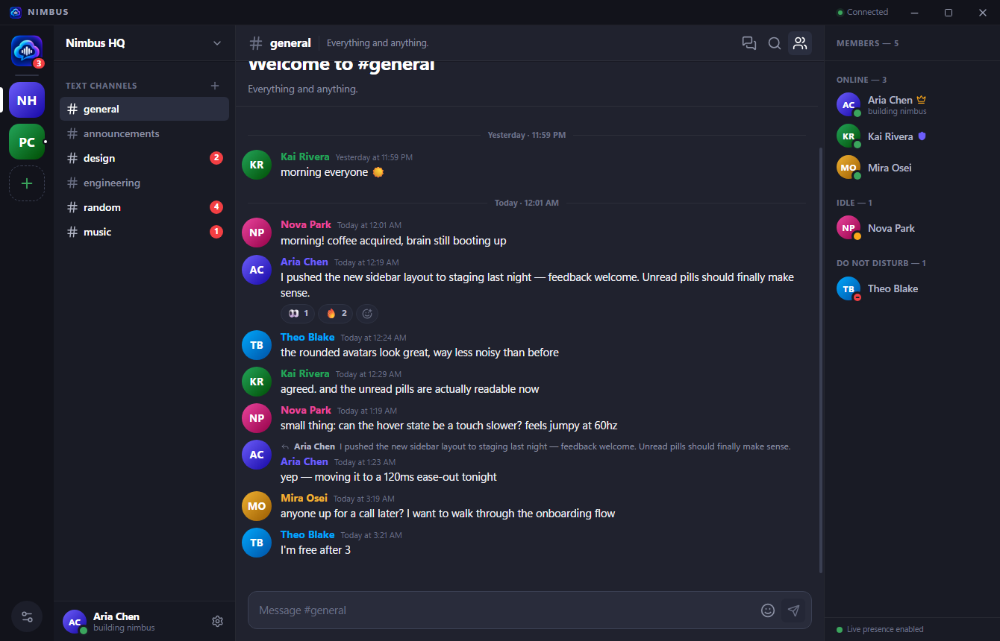
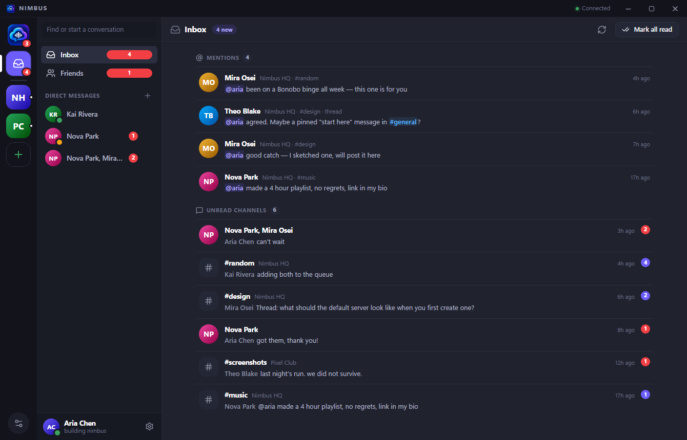
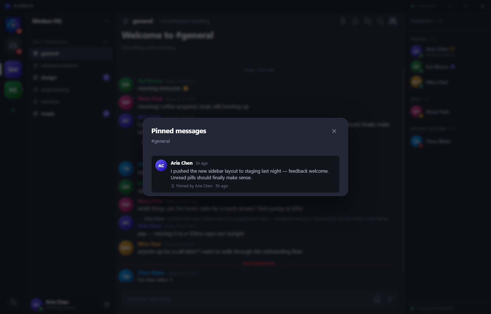
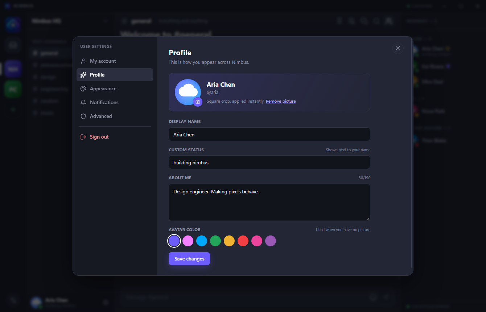
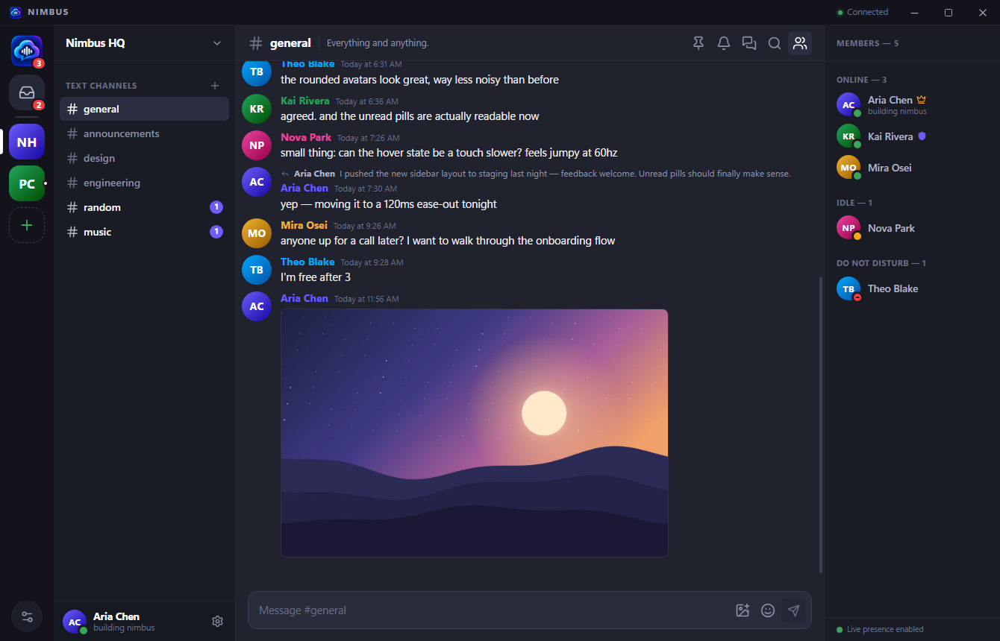
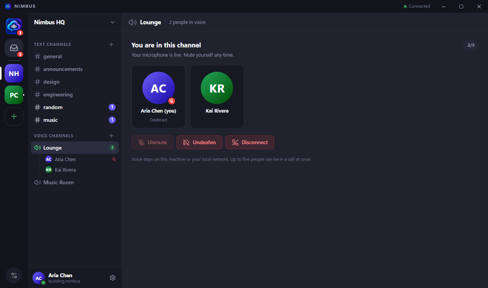
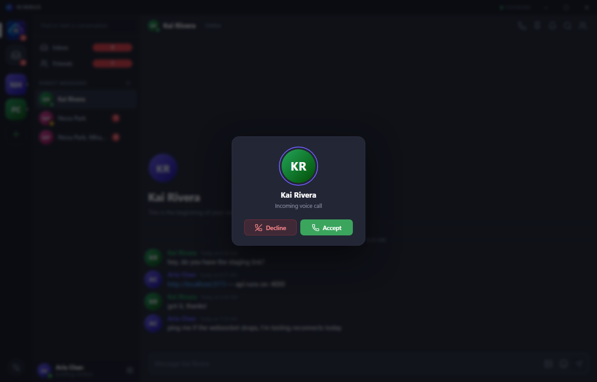

# Nimbus

A Discord-style desktop chat app — original branding, local-first backend, real-time messaging over a plain WebSocket.



Nimbus is a complete, self-contained chat client: Electron + React on the desktop, a small Node/Express/SQLite service on your machine. Nothing talks to Discord — the API, gateway and data model are Nimbus's own.

## Features

- **Servers, channels and threads** — create a server, join with a code or invite link, organise text channels, spin up threads from any message.
- **Roles & permissions** — owners and admins manage channels and curate pinned messages; only the owner can delete a server or promote members to admin.
- **Direct messages** — one-to-one and group DMs, with a friends list (requests, accept/decline, remove).
- **Real-time messaging** — message create/update/delete, replies, reactions, typing indicators and presence pushed over a raw WebSocket gateway.
- **Unread tracking** — per-channel read state, unread pills in the sidebar, dock badge and window title count.
- **Inbox** — one screen for unread `@mentions` and unread channels, newest first; clicking a row jumps straight to the message (threads included).
- **Search** — full-text-ish search across a channel, a server or everything you can see, with `from:`, `in:`, `before:` and `after:` operators and click-to-jump results.
- **Pins, drafts & unread markers** — pin messages to a channel, keep a separate draft per channel, and mark a channel unread to get a “New messages” divider.
- **Pictures in messages** — attach up to four pictures per message (picker, drag-and-drop or paste), shown in a grid with a full-screen viewer. Owners and admins can switch a channel to text-only for members.
- **Voice chat** — drop into a server voice channel or ring someone from a DM/group. Peer-to-peer audio (mesh, up to five people), mute/deafen, speaking rings and an incoming-call card. Share a screen — or several — in the same call.
- **Notification controls** — All messages / Only @mentions / Nothing per channel or per server; muting keeps unread counts but stops notifications.
- **Invite management** — invite links with expiry and max uses, plus a list where owners and admins can revoke codes.
- **Blocking** — block a user to stop DMs, friend requests and group adds in both directions.
- **Profiles & presence** — display name, bio, profile picture (centre-cropped to a square automatically), avatar colour fallback, custom status, online/idle/do-not-disturb/offline.
- **Auth** — email + password (scrypt), short-lived JWT access tokens, rotating refresh tokens hashed at rest.
- **Desktop niceties** — frameless custom title bar, native notifications, deep links (`nimbus://invite/<code>`, `nimbus://channel/<id>`, `nimbus://message/<id>`), dark/light themes and cozy/compact density.

Not included (on purpose, for v1): video, screen sharing, arbitrary file attachments (messages carry pictures only), mobile or browser builds.

## Stack

| Layer     | Choice                                                        |
| --------- | ------------------------------------------------------------- |
| Shell     | Electron 45 (frameless window, IPC bridge, `sandbox: true`)   |
| Renderer  | React 19, Vite 8, Zustand, lucide-react                       |
| API       | Node 20+, Express 5, Zod, better-sqlite3 (WAL)                |
| Realtime  | `ws` on `/gateway`, JSON events, 30 s heartbeat                |
| Voice     | WebRTC mesh (peer-to-peer), SDP/ICE relayed over the gateway   |
| Auth      | scrypt passwords, hand-rolled HS256 JWT, rotating refresh tokens |
| Language  | TypeScript everywhere, plain `.cjs` for Electron main/preload |

## Requirements

- **Windows 10/11** (the only platform packaged/tested for now)
- **Node.js ≥ 20.19** and npm 10+
- A C++ toolchain only if a prebuilt `better-sqlite3` binary is unavailable for your Node version

## Getting started

```bash
npm install
npm run seed -- --force   # create the demo workspace
npm run dev               # API :4000 + Vite :5173 + Electron window
```

`npm run dev` starts all three processes and shuts them down together.

### Demo account

| Email              | Password   |
| ------------------ | ---------- |
| `aria@nimbus.chat` | `nimbus123` |

Every seeded account uses `nimbus123` (`kai@`, `nova@`, `theo@`, `mira@`, `jules@`). The demo invite code is **`NIMBUS01`**.

### Roles and permissions

| Action                                   | Owner | Admin | Member |
| ---------------------------------------- | :---: | :---: | :----: |
| Read channels, send messages, use threads | ✅    | ✅    | ✅     |
| Send pictures (when the channel allows)   | ✅    | ✅    | ✅     |
| Join voice channels and DM calls         | ✅    | ✅    | ✅     |
| Pin / unpin messages                     | ✅    | ✅    | —      |
| Create / edit / delete channels          | ✅    | ✅    | —      |
| Allow or block member pictures per channel | ✅  | ✅    | —      |
| Rename the server                        | ✅    | —     | —      |
| Delete the server                        | ✅    | —     | —      |
| Kick members                             | ✅    | —     | —      |
| Grant / revoke the admin role            | ✅    | —     | —      |

Ownership comes from `guilds.owner_id`; admin is a per-server flag on `guild_members.role`. Seeded admins: **kai** in Nimbus HQ, **theo** in Pixel Club. The server enforces every rule (members get `403`), and the UI hides actions you cannot perform.

### Inviting people

1. Open a server, click its name, then **Invite people**.
2. Copy the invite link (`nimbus://invite/<code>`) or the short code.
3. Your friend opens the **+** button in the server rail and chooses **Join a server**, then pastes either one.

Invite links are also clickable when they appear in Nimbus messages: clicking one opens the join dialog with the server preview. The `nimbus://` protocol is registered with Windows the first time the desktop app launches, so links work from other apps too. Everything runs against the same local Nimbus backend — there is no hosted relay.

`npm run seed -- --force` wipes and rebuilds `server/data/nimbus.db`, so run it whenever the demo data gets messy.

### Inbox

The **Inbox** (rail icon or Home sidebar) collects everything you missed in one list:

- **Mentions** — messages that mention you by `@username`, squashed display name (`@ariachen`) or `@everyone`. Mentions stay here until you actually read the channel or choose **Mark all read**.
- **Unread channels** — every channel with messages you have not caught up on, with a message count and a one-line preview.
- Both lists are newest first. Clicking a mention loads the message (and opens the parent channel plus its thread when the mention lives in a thread); clicking a channel jumps to it.

Mention rows are stored in the database (`mentions` table) rather than guessed with text search, so `@aria` never matches `@ariane`. The desktop app also refreshes an open Inbox live when new messages arrive.



### Pins, drafts, notifications and more

- **Pinned messages** — choose **Pin message** from any message menu. Only the server owner and admins can pin or unpin (DMs and group DMs let their members pin). The pin button in the channel header lists everything pinned in that channel, with who pinned it and when. Pin changes are pushed live as `MESSAGE_UPDATE`.
- **Jump to a message** — search results and `nimbus://message/<id>` links resolve the message on the server, load the page that contains it, then flash it. Search understands `from:username`, `in:channel`, `before:YYYY-MM-DD` and `after:YYYY-MM-DD`.
- **Per-channel drafts** — unsent text is stored per user and per channel, so switching channels (or restarting the app) never loses it. Channels with a draft get a small dot in the sidebar.
- **Notification controls** — pick **All messages**, **Only @mentions** or **Nothing** per channel or per server. A channel setting beats the server setting; muting stops notifications but still shows unread counts. The same menu can **Mark as unread**.
- **Invite management** — when creating an invite you can set an expiry and a maximum number of uses. Owners and admins see every invite in the invite dialog and can revoke codes; expired, revoked and used-up invites are rejected by preview and join.
- **Blocking** — block a user from their profile. DMs, friend requests and group additions are refused in both directions, and an open DM composer explains why it is disabled. Unblock from the same profile.



### Profile pictures

Open **Settings → Profile** and press the camera button on your avatar. The picked image is centre-cropped to a square and resized in the renderer — no crop dialog to fight with — then uploaded once as a small WebP. Until you add a picture, Nimbus shows your initials on your chosen avatar colour; removing the picture returns to that fallback.

- The server verifies the bytes really are a PNG, JPEG or WebP and caps the stored image at 160 KB.
- Pictures are served from `/api/users/<id>/avatar?v=<upload-time>` with immutable caching, so a new upload shows up immediately without stale images.
- Changes are pushed to everyone who can already see you (shared servers, shared DMs, friends) as `USER_UPDATE`, so avatars update live in member lists and old messages.



### Pictures in messages

Press the picture button in the composer (or drop files onto it, or paste from the clipboard) to attach up to **four pictures** to a message. They are resized to a longest edge of 1600 px and encoded as WebP in the renderer before upload, so a phone screenshot does not turn into a 12 MB message.

- Pictures are uploaded first (`POST /api/attachments`) and then claimed by the message that is sent with their ids, so a failed send leaves nothing half-written. Unclaimed uploads are cleaned up after a day.
- Images are served from signed, immutable URLs (`/api/attachments/<id>?sig=…`). The signature is derived from the attachment id with a key domain-separated from the JWT secret, so only people who received the message DTO can load the picture — and an `` tag still works without an `Authorization` header.
- Click a picture to open the full-screen viewer; use the arrow keys or the on-screen arrows to move between pictures in a message and `Esc` to close.
- Deleting a message deletes its picture rows, so links that were already handed out stop resolving.
- A picture-only message has empty text: the Inbox, pinned list and reply previews all show “Photo” instead of a blank line.

#### Per-channel picture policy

Open a channel's settings (**right-click the channel → Edit channel**) and switch **Let members send pictures** off to make it text-only for members. Owners and admins keep the ability to post pictures, exactly like pinning, and DMs/group DMs always allow pictures because they have no roles. The rule is enforced by the API (members get `403` and the upload is left unsent); the composer shows a short note and disables the attach button.



### Voice chat

Nimbus has two ways to talk, both using the same peer-to-peer engine.

**Server voice channels.** Voice channels live next to text channels in the sidebar — the demo workspace ships with **Lounge** and **Music Room** in Nimbus HQ and **Arcade** in Pixel Club. Owners and admins create them with the same **Create channel** dialog (pick *Voice* instead of *Text*). Click a voice channel to join; the sidebar shows who is inside, with a red mic icon when someone is muted.



**DM and group calls.** Open a DM or group and press the phone button in the header. The other members get an incoming-call card with **Accept** / **Decline** (and a ringtone); the caller sees a floating call bar while it rings. Once someone picks up, the bar shows the call duration and the people in it.



How it works:

- **Mesh, no media server.** Every participant holds one `RTCPeerConnection` per other participant. The Node server only relays SDP and ICE candidates over the existing gateway — audio never touches it. That keeps Nimbus self-contained, and it is why a call is capped at **five people** (`VOICE_MAX`).
- **Perfect negotiation.** Both sides can offer at the same time; the peer with the lower user id yields and rolls back, so joining a busy room never deadlocks. ICE candidates that arrive before the remote description are queued instead of dropped, and a failed connection is retried with an ICE restart from the impolite peer.
- **Calls end for everyone.** A DM or group call is a conversation, not a room: the server closes the session for whoever is left when the second-to-last person leaves, and tells them with `VOICE_CLOSED` (`reason: peer-left`). The client applies the same rule as a fallback, so a lost frame cannot strand a one-person call. Server voice channels stay open, because people come and go in a room.
- **Ephemeral state.** Calls are in-memory only. The gateway socket is the source of truth: close the app, lose the connection, get kicked, leave the server or delete the channel and you drop out of the call immediately. A client that stays offline for eight seconds ends its call rather than leaving a frozen call bar.
- **Mute, deafen, speaking.** Mute stops your outgoing track; deafen also silences everyone else locally and mutes you. Speaking is detected with a small `AnalyserNode` and shown as a ring around the avatar.
- **Right microphone, right speaker.** **Settings → Voice** lists every input and output device, remembers your choice, and shows a live microphone meter so a dead device is obvious before you call. Automatic mode prefers the Windows *communications* device over the system default: on some machines the default input is a disconnected array that reports itself as live but never captures anything. If an automatic device comes back permanently muted, Nimbus tries the next one. Changing a device during a call swaps the live track without reconnecting.
- **Blocking applies.** A blocked pair cannot ring each other, and a blocked user cannot join a DM call that already has the other person in it.
- **Microphone permission.** Windows asks once. If no microphone is available (or you deny it), you still join and can hear everyone — you are simply muted, with a toast explaining why.

**Screen sharing.** Press the screen button in the call bar (DM/group) or in the room controls (server voice channel), then pick a screen or a window. Everyone in the call sees it in a floating stage they can minimize or put fullscreen, and a small badge marks who is sharing. Windows' own *Stop sharing* control ends a share too.

- **Video only.** System audio is deliberately not captured. Sharing it would add a second audio m-line and force a renegotiation in the middle of a mesh call; your microphone keeps working normally while you share.
- **No renegotiation to start or stop.** Each peer negotiates one `sendrecv` video m-line when the call is set up. Starting or stopping a share only calls `replaceTrack()`, so it cannot collide with another peer's offer. A tiny `VOICE_SIGNAL` frame (`kind: "screen"`) tells the other side to show or hide the stage immediately, instead of waiting for the remote track to mute.
- **Native picker in Electron.** `desktopCapturer` lists real screens and windows with thumbnails; the main process hands the chosen source to Chromium through `setDisplayMediaRequestHandler`, and only a source the user picked is ever captured. A browser build falls back to the browser's own `getDisplayMedia` chooser.
- **Mesh cost.** A share is uploaded once per peer, so it competes with your microphone upload. The same five-person cap and TURN guidance below apply to video.

**Calls across the internet need a TURN server.** Nimbus ships with public STUN servers only, which is enough for localhost and most home/office networks. Two peers behind strict carrier-grade NAT (or a corporate firewall that blocks UDP) may fail to connect. Point Nimbus at a TURN server before building:

```bash
VITE_TURN_URL=turn:turn.example.com:3478
VITE_TURN_USERNAME=nimbus
VITE_TURN_CREDENTIAL=secret
npm run dev        # or: npm run build
```

`VITE_TURN_URL` also accepts a comma-separated list (`turn:host:3478,turns:host:5349`). These are build-time Vite variables, so restart the dev server (or rebuild) after changing them; never commit real credentials.

**Two accounts on one machine.** `npm run dev` starts the app normally. With it already running, `npm run dev:second` starts a second, fully isolated instance (`--profile=second`) with its own `userData` folder, so you can sign in as another account and call between them. Any name works: `electron . --profile=alice`.

## Scripts

| Command                        | What it does                                              |
| ------------------------------ | --------------------------------------------------------- |
| `npm run dev`                  | Server + Vite + Electron in watch mode                     |
| `npm run dev:second`           | A second isolated Electron instance (`--profile=second`)   |
| `npm run build`                | Type-check/compile the server and build the renderer       |
| `npm run start`                | Launch Electron against the built renderer                 |
| `npm run typecheck`            | `tsc --noEmit` for both workspaces                         |
| `npm run seed -- --force`      | Reset the SQLite database to the demo workspace            |
| `npm run icons`                | Rebuild `desktop/build/icon.png` + `icon.ico` from `desktop/src/assets/nimbus-logo.png` |
| `npm run smoke`                | End-to-end API + gateway smoke test (166 assertions)       |

The smoke test expects the API to be running and cleans up everything it creates:

```bash
npm run dev:server          # in one terminal
npm run smoke               # in another
```

## Configuration

| Variable           | Default                              | Used by  |
| ------------------ | ------------------------------------ | -------- |
| `NIMBUS_PORT`      | `4000`                               | server   |
| `NIMBUS_DB`        | `server/data/nimbus.db`              | server   |
| `NIMBUS_JWT_SECRET`| dev fallback (change for real use)   | server   |
| `NIMBUS_DEV_URL`   | `http://127.0.0.1:5173`              | Electron |
| `VITE_API_URL`     | `http://127.0.0.1:4000`              | renderer |
| `VITE_TURN_URL`    | — (STUN only)                        | renderer |
| `VITE_TURN_USERNAME` | —                                  | renderer |
| `VITE_TURN_CREDENTIAL` | —                                | renderer |

## How realtime works

Mutating endpoints go through REST; the gateway only pushes. The client opens `ws://127.0.0.1:4000/gateway?token=<accessToken>` and receives `READY`, then events such as `MESSAGE_CREATE`, `MESSAGE_UPDATE`, `MESSAGE_DELETE`, `REACTION_UPDATE`, `TYPING_START`, `PRESENCE_UPDATE`, `USER_UPDATE`, `MEMBER_JOIN`, `MEMBER_UPDATE`, `GUILD_CREATE` and `THREAD_ACTIVITY`. A `PING`/`PONG` pair keeps the socket alive; on disconnect the client reconnects with backoff and re-bootstraps. `MESSAGE_CREATE` payloads carry the resolved `mentions` user ids, so clients can badge a mention without re-parsing the text, plus the message's `attachments` so pictures appear without a follow-up request.

The gateway is also the voice signalling channel. Clients send `VOICE_JOIN`, `VOICE_LEAVE`, `VOICE_STATE`, `VOICE_RING`, `VOICE_DECLINE`, `VOICE_CANCEL` and `VOICE_SIGNAL` (SDP/ICE, plus the small `screen` share-state frame); the server answers with `VOICE_JOINED`, `VOICE_STATE_UPDATE`, `VOICE_LEFT`, `VOICE_RING`, `VOICE_RING_SENT`, `VOICE_DECLINE`, `VOICE_CANCEL`, `VOICE_RING_END`, `VOICE_SIGNAL`, `VOICE_ERROR` and `VOICE_CLOSED`. Signals are only relayed between two sockets already in the same session, and `VOICE_ERROR` carries the originating frame in `stage` so the client can tell a failed join from harmless signalling noise. `VOICE_CLOSED` carries a `reason` (`peer-left`, `channel-deleted`, `server-removed`) so the client can show the right message; a DM or group call is closed for the remaining participant when everyone else leaves, while server voice channels stay joinable.

## Project layout

```
nimbus/
├─ server/                 # @nimbus/server — Express API + WS gateway
│  ├─ src/
│  │  ├─ index.ts          # app wiring, routers, error handling
│  │  ├─ db.ts             # SQLite schema + migrations
│  │  ├─ auth.ts           # scrypt, JWT, refresh tokens, middleware
│  │  ├─ ws.ts             # /gateway
│  │  ├─ hub.ts            # connection registry + fan-out
│  │  ├─ voice.ts          # ephemeral voice sessions + signalling relay
│  │  ├─ payloads.ts       # bootstrap/guild/inbox payload builders
│  │  ├─ serialize.ts      # row → DTO mappers
│  │  ├─ avatars.ts        # profile picture validation, sniffing, read-back
│  │  ├─ images.ts         # shared data-URL parsing + magic-byte sniffing
│  │  ├─ attachments.ts    # message picture limits, signed URLs, DTOs
│  │  ├─ mentions.ts       # @mention extraction, storage, backfill
│  │  ├─ seed.ts           # demo workspace
│  │  └─ routes/           # auth, users, guilds, messages, media, social, invites, inbox, prefs
│  └─ data/nimbus.db       # created on first run (gitignored)
├─ desktop/                # @nimbus/desktop — Electron + React
│  ├─ electron/            # main.cjs, preload.cjs
│  ├─ build/               # app icons
│  └─ src/
│     ├─ components/       # rail, sidebar, chat, modals, settings…
│     ├─ store/store.ts    # Zustand store + gateway reducer
│     ├─ store/voice.ts    # WebRTC mesh, ringing, mute/deafen, screen share
│     ├─ lib/              # api, gateway, markdown, format, avatar, attachments, image, audio, theme
│     └─ styles.css        # design system + themes
├─ scripts/                # icon generator, smoke test
└─ docs/                   # screenshots
```

## Notes and limitations

- This is a **single-node** backend: SQLite, in-process WebSocket fan-out, no clustering or horizontal scale.
- Message pictures and avatars are stored inside `nimbus.db` as data URLs, so an install is still a single file to back up. That is comfortable for a demo workspace, not for a large community — a real deployment would move pictures to object storage.
- Demo users have simulated presence so the member list looks alive without extra clients connected.
- Voice is a **mesh** capped at five people. That is deliberate: no SFU, no extra service, no hosting. Larger calls would need an SFU (LiveKit, mediasoup, …) and a real deployment would add TURN for reliable internet calls. Without TURN, two peers behind strict NAT can see a connected call with no audio; the diagnostics (`localStorage['nimbus.voice.debug'] = '1'`) report the ICE state when that happens.
- Screen sharing is **video only** and is sent once per peer over the same mesh. There is no simulcast or SVC, so each sharer uploads a full stream to every participant; a large share on a slow uplink will also degrade the sharer's microphone. System audio, remote control and per-window audio are out of scope.
- There is no installer yet — `npm run start` runs the built app from source. Packaging (electron-builder) is the natural next step.
- `npm run dev` binds Vite to `127.0.0.1` so the Electron `wait-on` probe and `VITE_API_URL` agree on the same loopback address.
